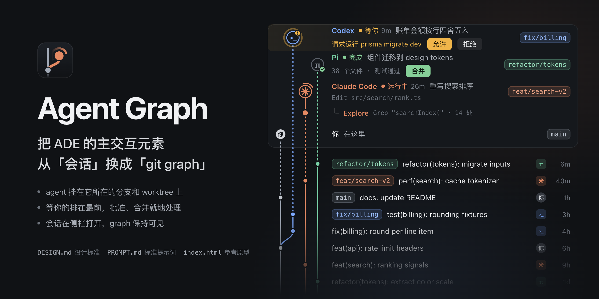

# Agent Graph

把 ADE（agent 开发环境）的主交互元素从「会话」换成「git graph」的一次交互探索。

https://github.com/user-attachments/assets/123cfb00-07ef-4b2b-b531-33635909f158

这个仓库不是一个应用，也不包含可以直接安装的功能实现，只有三样东西：

| 文件 | 内容 |
| --- | --- |
| [DESIGN.md](DESIGN.md) | 设计标准：交互模型、视觉编码、git 操作规则、适配原则 |
| [PROMPT.md](PROMPT.md) | 标准提示词：不绑定任何 ADE 和技术栈，让 agent 在你的 ADE 里实现这套交互 |
| [index.html](index.html) | 参考原型：单文件，用示例数据演示全部交互，浏览器直接打开 |

## 为什么

现在的 ADE 大多以会话为主元素：一列 session，点开是对话。同时跑的 agent 一多，有些事在会话列表里很难看清：

- 每个 agent 在哪个分支、哪个 worktree 上，改动落在哪
- 谁派出了哪些子 agent，谁在 review 谁的分支
- 哪些 agent 在等你批准，哪些做完了可以合并
- 提交、推送、合并、清理 worktree，还得切到终端或 git 客户端

agent 的工作最后都落在 git 上。所以换一个主元素：git graph 是主视图，agent 挂在它所在的分支和 worktree 上，状态实时可见；会话退到侧栏，需要时再打开。

## 交互模型

- **一个项目一张 graph**：上面是「现在」，即每个 worktree 和在里面工作的 agent、子 agent；下面是提交历史。多个项目可以并排
- **状态在头像上**：运行中、等你、完成、空闲。需要你处理的 worktree 排在最前
- **就地处理**：等你批准的请求在 graph 上直接允许或拒绝，做完的分支直接合并
- **会话在侧栏**：点一个 agent，右侧打开它的对话，graph 保持可见；对话里的提交能在 graph 上定位
- **git 快捷操作**：右键 worktree、agent 或分支，可以提交、推送、合并、变基、删除。暂时不能做的写明原因，能做的标出对应的 git 命令
- **多个 harness 同屏**：Claude Code、Codex、Pi 等出现在同一张图上，用颜色和头像区分

完整规则见 [DESIGN.md](DESIGN.md)。

## 使用

前提是你能改这个 ADE 的源码，比如 t3code 这类开源 ADE 的 fork，或者你自己的 harness 前端。

在 ADE 的源码仓库里开一个 agent 会话，发送：

```text
把 https://github.com/jihe520/agent-graph 克隆到一个临时目录，读其中的 PROMPT.md，按它的要求在当前项目里实现。
```

agent 会先调研你的 ADE，交给你概念映射和实施计划，确认后再分阶段实现。agent 不能联网或执行命令时，把 PROMPT.md、DESIGN.md、index.html 复制进当前项目，再让它读 PROMPT.md。

只想看效果的话，直接打开[在线预览](https://jihe520.github.io/agent-graph/)，或者用浏览器打开 index.html。

## 适配不同的 ADE

提示词不假设宿主的技术栈和叫法，而是让 agent 先把概念对上：

| 本模型 | 宿主里可能叫 |
| --- | --- |
| 项目 | project、workspace、repo |
| agent | session、thread、task、conversation |
| harness | provider、runtime、CLI agent |
| 等你 | approval、permission request、user input |
| 子 agent | subagent、task、spawned agent |
| worktree | worktree、sandbox、checkout |

宿主缺的能力，比如没有 worktree、没有子 agent、只有一种 harness、是终端界面，都有对应的降级方式，见 DESIGN.md 的[适配](DESIGN.md#适配)一节。

## 现状

- 处在探索阶段，设计标准和提示词都还会改。下一步是在 t3code 上跑通提示词，再根据结果修订
- 原型里的数据和实时变化都是模拟的；顶栏的「实时」「重置」只服务于原型，不属于交互模型
- 不做的事：替代 git 客户端（看 diff、解决冲突），重写会话界面（直接复用宿主的）

## 参与

- 在你的 ADE 上跑一遍提示词，把截图、概念映射表和卡住的地方发到 issue，用来修订 DESIGN.md 和 PROMPT.md
- 改交互时，原型和 DESIGN.md 一起改，保持一致

## 修改原型

index.html 没有依赖，也不需要构建：

- 示例项目、分支、worktree 和 agent：`seed()`；示例对话：`LOGS`
- harness 名称和颜色：`HARNESS`；分支配色：`PALETTE`
- 模拟的操作、提交信息和子 agent：`SCRIPT`、`SUB_SCRIPT`、`MSGS`、`TEMPLATES`、`SUB_TASK`、`SUB_DONE`
- 行高、泳道宽度、模拟间隔：脚本开头的常量
